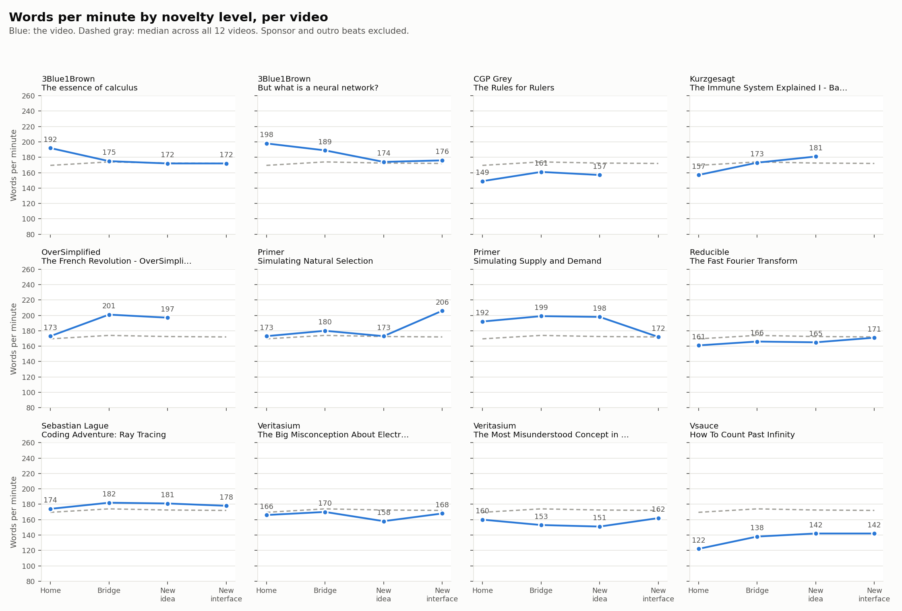

# Pedagogy teardown: how the best YouTube explainers actually teach

Research behind the tutor in **Carrel**, my macOS AI tutor. The question: what do great explainers (3Blue1Brown, Veritasium, Vsauce, CGP Grey, Kurzgesagt, Primer, Reducible, Sebastian Lague, OverSimplified) *do* when they teach, and can those moves be written down well enough that a model teaches better with them?

## Round 1: hand teardown of 12 videos ([pedagogy-teardown.md](pedagogy-teardown.md))
- 383 hand-annotated teaching beats (`beats.csv`) tagged by novelty level and teaching move; rerunnable stats in `tools/analyze.py`.
- **Speech rate stays flat across novelty**: about 170 words per minute on familiar ground, 173 on new ideas, 172 on new notation. Explainers slow the *idea rate* instead, with longer beats, a concrete special case, a stated misconception and an honest caveat.
- Two moves appear in all 12 videos: **special case first** and **minimal definition, then refine**. An honest caveat appears in 11 of 12.
- Takeaway for a tutor: pace by concepts per minute, not words per minute.

## Round 2: per-channel reports, rulebooks and storyboards (`deep/`)
- Agent pipeline (`deep/BRIEF.md`, `deep/REPORT_BRIEF.md`) analysed each video against 13 working principles and produced per-channel reports (`deep/reports/`), interactive storyboard pages (`deep/storyboards/*.html`) and machine-usable rulebooks with rule IDs, numeric bands and default switches (`deep/policy/`, `deep/policy_v3/`).

## Round 3: does the teardown help a model write like the channel? ([deep/round3/RESULTS.md](deep/round3/RESULTS.md))
- Frozen test set of 81 held-out videos across 9 channels; 243 generated scripts in three conditions (title only, plus prose report, plus rulebook and exemplars).
- **Deterministic scoring, no LLM judge**: the same feature code runs on generated narration and the real transcript; error is normalised by each channel's IQR; paired sign tests plus bootstrap 95% CIs.
- **The rulebook works; the prose report doesn't.** Fidelity error 1.11 base vs 0.97 with the rulebook (paired, 60 of 81 better, p<0.001); features inside the channel's p25–p75 band rose from 37% to 65%; sponsor/teaser/roadmap/recap switch agreement from 66% to 77%. The prose report alone gave no significant change.
- Rulebook scripts beat the real-vs-real bar (another real episode from the same channel) on 67 of 81 videos, but still lose to a constant-median baseline, and hook and ending predictions stay below the majority baseline. Write-up includes the failures: self-reported rule compliance was wrong 74 times, and 3Blue1Brown is the one channel where the rulebook hurt.

## Notes
- Raw transcripts and the downloaded corpus are not included (copyright); scripts to refetch them are referenced in the briefs.
- Built with Claude Code subagents plus plain Python for all measurement.

— Suddala Revanth · [github.com/s-revanth](https://github.com/s-revanth) · [x.com/rev_entropy](https://x.com/rev_entropy)
