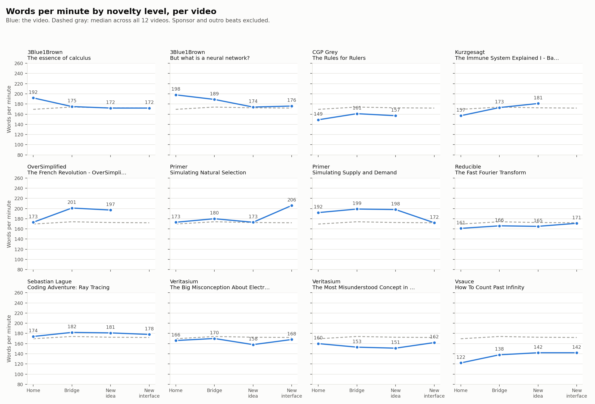

# Pedagogy teardown: 12 top YouTube explainers

*2026-11-02 · Input for the Velocity PRD*

**Bottom line.** The best explainers do not slow their speech for new material. Median speaking rate is flat across novelty levels: 170 words per minute (wpm) on familiar ground, 173 on new ideas, 172 on new notation. They slow the *idea rate* instead. A new idea gets a longer beat (median 28 s for Home, 36 s for New interface), a concrete special case, a stated misconception, a visible repetition and an honest caveat. Two moves appear in all 12 videos: **special case first** and **minimal definition, then refine**. An **honest caveat** ("this may not be exactly how it works") appears in 11 of 12, and none of our 13 principles covers it. Velocity should pace by concepts per minute, not words per minute.

Files in this folder: `beats.csv` (383 beats), `wpm_by_novelty.png`, `work/beats/*.json` (hand annotations), `work/stats.json`, `tools/analyze.py` (rerunnable). Raw transcripts in `transcripts/` stay local.

---

## 1. Method

- **Transcripts**: fetched from the local transcript server (`127.0.0.1:8765/api/transcript?timestamps=true`). 10 have manual captions. **Reducible FFT and Vsauce are auto-generated**: no punctuation, "aleph" heard as "Alf". Still usable for beats and wpm.
- **Beats**: I segmented each video by hand into teaching moves (383 beats in all, median 33 s). Each beat has a novelty level and one or more move tags. A beat's words are the caption segments whose midpoint falls inside it.
- **Novelty levels**: Home (familiar world, story, everyday objects), Bridge (leaving an analogy, connecting to the new), New idea, New interface (notation, formula, code, a new chart type).
- **Excluded**: sponsor reads, Patreon thanks and outros (tag `admin`) are left out of every rate and share.
- **Limits**: one annotator, no inter-rater check. Caption timing is too coarse to measure pauses, especially for rolling auto-captions, so silence-based slowdown is **inconclusive**, not absent. Concrete share counts Home plus Bridge time.

Video swaps and renames: CGP Grey's *Rules for Rulers* now carries the title "Try to Rule Fairly and You'll Be Overthrown" (same ID). The list left the electricity, supply-and-demand, FFT, ray tracing and immune-system IDs open, so I resolved them by search. For the open slots I picked *How To Count Past Infinity* (Vsauce) and *The French Revolution, Part 1* (OverSimplified).

---

## 2. Per-video summary

| # | Video | Subject | Min | Beats | 1st question | Notation first (share of runtime before it) | Concrete share | Key term (repeats in 2 min) | Misconception set up, then broken | Naive approach first | Examples, and how they grow | Ending |
|---|---|---|---|---|---|---|---|---|---|---|---|---|
| 1 | 3Blue1Brown, *But what is a neural network?* (aircAruvnKk) | CS / ML | 18.4 | 25 | 5:36 | 13:22 matrix form (72%) | 41% | neuron (10) | No | Yes, 11:42: element-by-element sums, 13k hand-set knobs | 1 running case (digits), scaled from 1 neuron to a whole function | Teaser + expert caveat interview |
| 2 | 3Blue1Brown, *The essence of calculus* (WUvTyaaNkzM) | Math | 16.7 | 26 | 1:22 | 3:14 dr as "about 0.1" (19%) | 41% | dr (8) | Partly: calculus as memorized rules | Yes, 5:36: monstrous sum of rectangles | 3: circle r=3, general R, x²; abstraction grows | Recap + callback to "you could have invented it" |
| 3 | Veritasium, *The Most Misunderstood Concept in Physics* (DxL2HoqLbyA) | Physics | 27.2 | 45 | 0:19 | 8:00 Carnot efficiency (29%) | 42% | entropy (6) | Yes, 4 times; first broken at 1:28 | Partly: counts configurations at small scale | 6+; 8 atoms to 80 to real solids to the universe | Callback to the sun question + tea-and-milk image |
| 4 | Veritasium, *The Big Misconception About Electricity* (bHIhgxav9LY) | Physics | 14.8 | 26 | 0:16 | 4:19 Poynting vector (29%) | 52% | Poynting (5) | Yes: his own chain analogy, broken at 2:07 | No | 4: light, DC, AC, undersea cable | Callback answers the hook + caveat |
| 5 | CGP Grey, *Rules for Rulers* (rStL7niR7gs) | Political science | 18.2 | 31 | 0:00 | none (numbered rules instead) | 32% | keys (7) | Yes: rulers are stupid, benevolence is safe, people topple kings | No | Many; the same 3 rules re-run on king, dictatorship, democracy, any organization | Generalize + callback to "you, the ruler" |
| 6 | Primer, *Simulating Natural Selection* (0ZGbIKd0XrM) | Biology | 9.7 | 20 | 2:14 | 4:43 size³×speed² (48%) | 30% | natural selection (4) | Yes, including the presenter's own failed predictions | Yes, 1:05: run with no mutations first | 4 runs; 1 trait, 3 traits, scarce food | Recap + teaser |
| 7 | Primer, *Simulating Supply and Demand* (PNtKXWNKGN8) | Economics | 12.4 | 25 | 4:08 | 7:24 supply/demand curves (60%) | 26% | surplus (1) | Partly: the idealized model is questioned | Yes, 3:48: 1 buyer, 1 seller, nothing happens | 5 sizes: 1×1, 2×1, 2×3, 3×3, many; strictly growing | Recap ("markets are a tool") + joke |
| 8 | Reducible, *The Fast Fourier Transform* (h7apO7q16V0), auto captions | Algorithms | 28.4 | 35 | 3:04 | 2:36 coefficient list (9%); ω notation at 16:21 | 15% | value representation (4) | Partly: a planted trap at 12:29 | Yes, twice: O(d²) distributive law; random evaluation points | 6 cases; line, x², n=4, n=8, general n | Recap of 4 ideas + callback |
| 9 | Sebastian Lague, *Coding Adventure: Ray Tracing* (Qz0KTGYJtUk) | CS / graphics | 37.7 | 55 | 29:57 | 1:46 code (5%) | 26% | ray (4) | Yes: rays seem backwards; the tomato's white highlight | Yes, often: home-made RNG, rejection sampling, no-sqrt circle | Many scenes; sphere, spheres, triangles, meshes, materials, camera | Teaser |
| 10 | Kurzgesagt, *The Immune System Explained I* (zQGOcOUBi6s) | Biology | 6.5 | 21 | 0:52 | 0:35 color code (9%) | 68% | macrophages (2) | No | Yes, 0:17: full 21-cell tangle, then simplified | 1 escalating story (a cut) | Caveat ("very simplified") + wonder |
| 11 | Vsauce, *How To Count Past Infinity* (SrU9YDoXE88), auto captions | Math | 23.8 | 41 | 0:00 | 2:21 aleph-null (10%) | 31% | aleph-null (6) | Yes: infinity as the biggest number; +1 makes it bigger | Yes: 41, 42, googolplex towers | Many; finite to ℵ₀ to ω ladders to ℵ₁ to inaccessibles | Philosophical callback + open questions + post-credits bonus |
| 12 | OverSimplified, *The French Revolution, Part 1* (8qRZcXIODNU) | History | 17.9 | 33 | 2:35 | none (characters and skits) | 66% | estate (5) | Partly: glamorous France undercut by sarcasm | No | Skits, in chronological order with rising stakes | Sponsor + teaser |

**Cross-video medians**

- First question to the viewer: 1:48. Three videos open with one (CGP Grey, Vsauce at 0:00; Veritasium electricity at 0:16). Sebastian Lague waits until 29:57 and asks himself questions instead.
- First notation: 3:46 in the 10 videos that use any. Heavy notation comes much later: 13:22 (neural net), 16:21 (FFT ω).
- Concrete share (Home + Bridge): 37%. History and biology run about 67%; math and CS run 15–41%.
- Key term repeats in the 2 minutes after introduction: 5 (range 1–10).
- Each video's single quote is in section 7.

---

## 3. Words per minute by novelty: the bridge-principle test

| Level | Median wpm | Median beat length | Median share of runtime |
|---|---|---|---|
| Home | 170 | 28 s | 16% |
| Bridge | 174 | 33 s | 22% |
| New idea | 173 | 33 s | 52% |
| New interface | 172 | 36 s | 10% |

**Speech rate does not drop on new material.** Only 4 of 12 videos speak more slowly on new ideas than at Home: both 3Blue1Brown videos and both Veritasium videos. The clearest case is the neural-net video: 198 wpm Home, 174 on new ideas. Kurzgesagt, Vsauce, OverSimplified and CGP Grey get *faster* as they leave Home, because their Home beats are jokes and pauses for effect.

**How they slow down instead.** Looking across the beats, the slowdown shows up in these places:

1. **Longer beats.** A new-interface beat runs about 30% longer than a Home beat. The neural net's matrix-notation beat is 108 s, the longest in that video.
2. **More examples per idea.** The FFT spends about 14 minutes on concrete point-picking before ω notation appears.
3. **Repeating the same operation.** Veritasium does the right-hand rule three times, and CGP Grey reruns the same 3 rules in each setting.
4. **Late notation.** The median video runs 3:46 of concrete setup before its first symbol.

**Implication.** Principle 8 is right about *distance from reality* but wrong about the knob. Slow the rate of new concepts, and keep the voice at a natural 160–180 wpm. Slow speech on new material would be a tell that the tutor is out of better moves.

---

## 4. Move catalog

The taxonomy as given, plus new tags marked ★. "Videos" counts how many of the 12 use the move.

| Move | Videos | Beats | Example 1 | Example 2 |
|---|---|---|---|---|
| special-case-first | 12 | 39 | Calculus 1:22: one circle of radius 3 carries all of integration | FFT 8:44: drop to x² at 8 points to find the ± pairing trick |
| minimal-definition-then-refine | 12 | 38 | Neural net 2:39 then 15:10: a neuron "holds a number", later refined to a function | Vsauce 1:28 then 7:04: cardinals count, ordinals label, order type ties them together |
| ★ honest-caveat | 11 | 34 | Neural net 7:35: the layered-edges story may not be what the trained net does | Primer 4:43: admits the size-cubed cost function is his choice |
| act-it-out | 10 | 26 | Veritasium entropy 4:03: walks Carnot's engine stroke by stroke, then in reverse | Vsauce 4:09: re-pairs lines by hand to show ℵ₀+1 = ℵ₀ |
| visible-repetition | 10 | 22 | CGP Grey 6:26–8:51: the dictator's rules replayed on voters, blocks and donors | OverSimplified 9:04: every vote goes two to one against the third estate |
| generalize-to-other-domains | 10 | 24 | Calculus 8:19: same move gives distance from velocity | Sebastian 30:14: the tomato's clear coat explains varnished wood |
| callback-to-hook | 10 | 20 | Veritasium entropy 16:09: what the sun really gives is low entropy | Electricity 11:42: the light-second wire question is answered |
| misconception-first | 9 | 26 | Electricity 1:21–2:07: his own chain-in-a-tube teaching analogy is stated, then broken | Primer 3:27: populations evolve, not individuals |
| hook-paradox | 9 | 21 | Neural net 0:04–0:42: reading a 3 is effortless but programming it is daunting | Entropy 12:30: heat flows cold to hot in the toy model |
| hook-question | 9 | 18 | Vsauce 0:00: what's the biggest number you can think of? | CGP Grey 0:15: are rulers stupid, or is it something else? |
| notation-after-concept | 9 | 17 | Calculus 3:14: dr named after the rings exist, and called "about 0.1" | Supply/demand 7:24: curves only after 7 minutes of blobs |
| recap | 9 | 16 | Calculus 4:07: mid-video sum-up before the key leap | FFT 26:48: four ideas listed |
| learner-discovers (staged) | 8 | 28 | FFT 11:04: "this is starting to smell recursive" | Supply/demand 6:36: only 2 rockets sell with 3×3; why? |
| teaser-next | 8 | 9 | Neural net 15:59: learning comes next | Primer 9:22: counterintuitive traits next |
| brute-force-first | 7 | 12 | FFT 2:21: the distributive law is O(d²) | Kurzgesagt 0:17: the whole 21-cell tangle shown, then simplified |
| toy-world | 7 | 14 | Primer 0:33: blobs, food, three survival rules | Entropy 11:40: 8 atoms, 10 energy packets |
| analogy | 7 | 16 | Entropy 14:10: Rubik's cube scrambling | Kurzgesagt 1:31: macrophages as border guards |
| ★ roadmap | 6 | 6 | Supply/demand 0:00: start with 1 buyer and 1 seller, build to a market | Neural net 1:15: structure now, learning next |
| multiple-decompositions | 6 | 12 | Calculus 1:59: tries many slicings, picks rings for symmetry | FFT 15:10: the same points seen as solutions of x⁴ = 1 |
| notation-compaction | 6 | 7 | Neural net 13:22: weighted sums become one matrix-vector line | Kurzgesagt 0:35: the tangle compressed into a color code |
| simulation-as-argument | 5 | 15 | Primer 2:54: speed wins, shown, not argued | Entropy 13:19: 10.5% at 8 atoms, 0.05% at 80 |
| design-it-yourself | 5 | 8 | Neural net 8:23: what knobs would a layer need? | Sebastian 34:40: offset the ray origins instead, and focus appears |
| ★ story / history frame | 5 | 28 | Entropy 2:01: teenage Carnot and Napoleon | Electricity 10:05: the failed 1858 transatlantic cable |
| running-character | 4 | 14 | OverSimplified: Louis and "fat, ill-bred boy" as a running gag | Primer: blob creatures across videos |
| inline-quiz | 4 | 7 | Primer 2:14: four possible outcomes before unpausing | FFT 12:29: "can you spot the issue?" |
| ★ commit-to-answer | 2 | 2 | Electricity 0:48: write your answer in the comments before the reveal | Primer 2:14: predict before unpausing |
| approximation-gets-less-wrong | 3 | 6 | Calculus 3:32: the rectangle error shrinks with dr | Sebastian 18:05: more rays per pixel, less noise |
| analogy-breakpoint | 3 | 5 | Electricity 2:07: the chain analogy fails at transformers | Entropy 11:08: "disorder" replaced by "energy spreading" |
| ★ humor | 3 | 17 | Vsauce 0:12: the biggest number is a 40 planted in trees | Sebastian 16:40: "photorealistic room without light" |
| ★ rule-list | 3 | 4 | CGP Grey: rules 1–3 plus a zeroth rule | Primer 0:33: three survival rules |
| ★ build-and-verify | 1 | 7 | Sebastian 4:28: direction as color; checks red when looking along +x | Sebastian 6:44: "seems pretty spherical" |
| ★ failure-shown | 1 | 4 | Sebastian 11:50: stuck in a while-true loop, crashes the computer | Sebastian 26:51: an optimization breaks the monkey model; reverted |
| ★ presenter-was-wrong | 1 (Primer); Sebastian similar | 3 | Primer 6:49: expected sense to win; it didn't | Primer 8:24: expected efficiency to win in scarcity; speed did |
| ★ second-person-role | 1 | 4 | CGP Grey 0:00: you are the aspiring ruler | CGP Grey 17:37: "maybe you'll be different" |
| ★ expert-dialogue / street interview | 2 | 6 | Entropy 0:19: strangers guess what Earth gets from the sun | Neural net 17:07: guest researcher says sigmoid is outdated |
| ★ show-full-complexity-then-zoom | 1 | 1 | Kurzgesagt 0:17–0:52: all 21 cells, then "we'll only talk about these" | (Neural net 4:06: hidden layers left as a "giant question mark") |
| ★ you-could-invent-it | 1 | 1 | Calculus 0:49: you could have invented calculus yourself | (Reducible 1:51: a discovery-based approach) |

**Veritasium check (misconception first).** 6 videos clearly state a viewer-held wrong belief and then break it: both Veritasium videos, CGP Grey, Primer natural selection, Sebastian Lague and Vsauce. 4 do it partly: calculus, FFT, supply and demand, OverSimplified. 2 never do: the neural net and Kurzgesagt. Veritasium is the most aggressive. It plants the misconception with real people (street interviews), uses the presenter's own old teaching analogy as the wrong model, and asks viewers to commit to an answer.

---

## 5. Principle scorecard

| # | Principle | Verdict | Evidence |
|---|---|---|---|
| 1 | Start from the familiar | **Confirmed** | All 12 open on a Home beat (a blurry 3, strangers, a rusty nail, "the biggest number"). |
| 2 | Abstractions cost effort; every symbol adds load | **Confirmed** | Median 3:46 before the first symbol. Notation is introduced as compression of something already understood (neural net matrix, Kurzgesagt color code). Calculus keeps dr concrete as "about 0.1". |
| 3 | Comfort comes from habit with interfaces | **Partly** | Videos can't make viewers practise. The nearest thing is repeated use on screen: the right-hand rule three times, build-and-verify after every Sebastian Lague step. Velocity can do what video can't here. |
| 4 | Analogy first, then step toward rigor | **Partly** | Analogy appears in 7/12, but special case first appears in 12/12 and does more of the work. Analogies are often deliberately broken (electricity, entropy). FFT and Primer use no analogy at all. |
| 5 | Act out the problem literally | **Confirmed** | 10/12: engine strokes, line re-pairing, unrolled rings, tax-collector skits. |
| 6 | Dumb way first, with a neat scratch pad | **Confirmed** | 7/12 show the naive method. Neat scratch pads are the norm: tidy tables (Primer price bars, Vsauce's yes/no subset grid). |
| 7 | Learner discovers the insight through visible repetition | **Partly** | Visible repetition 10/12 and staged discovery 8/12. But the discovery is staged: the narrator asks and then answers within seconds. Only Veritasium's commit-to-answer and Primer's "what would you predict?" give the viewer a real turn. |
| 8 | Pace by distance from reality; slower when new | **Contradicted for speech rate; confirmed for idea rate** | Median wpm 170 Home vs 173 New idea vs 172 New interface. Beats get longer and examples multiply instead (section 3). |
| 9 | Repeat across examples until it sticks | **Confirmed** | CGP Grey reruns 3 rules in 4 settings. Key term repeated a median 5 times in its first 2 minutes. |
| 10 | Tiny to bigger examples | **Confirmed** | Supply and demand 1×1 to many; entropy 8 atoms to 80 to 10²⁴; FFT n=4 to 8 to n. |
| 11 | Dependency order, with invented stepping stones | **Confirmed** | FFT invents polynomial multiplication as the stepping stone; calculus uses circle area to reach the integral. |
| 12 | Connect everything, including outside sources | **Partly** | Generalize-to-other-domains in 10/12. Outside sources are pointed to (linked proof, linear algebra series, ray-tracing book) but rarely brought in as subproblems. |
| 13 | Simple for a 12-year-old, expert depth, explain why each tool is chosen | **Confirmed** | Why-this-tool is explicit: rings respect symmetry, spheres as pure math for accuracy, cube cost because volume scales as a cube. Honest caveats in 11/12 carry the expert depth. |

---

## 6. New moves we don't have yet

1. **Honest caveat** (11/12). Say where the model is simplified, where experts disagree, or what isn't known. It builds trust and marks the edge of the model before the learner hits it.
2. **Minimal definition, then refine** (12/12). Give the smallest definition that lets you proceed ("a thing that holds a number"), then upgrade it out loud later. A distinct move from analogy.
3. **Callback to the hook** (10/12). Close the loop the opening question opened. The answer lands harder because the learner has been holding the question.
4. **Commit to an answer** (Veritasium, Primer). Make the learner commit before the reveal so the misconception is on record. Muller's finding depends on this.
5. **Presenter was wrong / failure shown** (Primer, Sebastian Lague). The teacher's own failed predictions and crashes, shown openly. It models how experts work and makes being wrong normal.
6. **Build and verify** (Sebastian Lague). After every small step, run a visible check that should obviously look right (red when looking along +x). Fits programming exactly.
7. **Show the full complexity, then zoom in** (Kurzgesagt). Show the whole tangle once, then say "we'll only follow these four". The learner knows the map exists and that the rest was skipped on purpose.
8. **Roadmap** (6/12). One sentence on where we start and where we will end.
9. **Second-person role** (CGP Grey). The learner is cast as the actor ("you, the ruler"). Strong for social science and history.
10. **Running character and humor** (OverSimplified, Kurzgesagt, Primer). Recurring characters and gags carry the dull parts.
11. **Rule list as the interface** (CGP Grey). For subjects with no notation, numbered rules serve as the notation.
12. **Street interview / real people guessing** (Veritasium). Other people's wrong answers make the misconception feel common and safe to hold.
13. **You could have invented this** (3Blue1Brown, Reducible). Frame the lesson as a problem the learner could have solved.

---

## 7. One quote per video (each under 15 words)

| Video | Timestamp | Quote |
|---|---|---|
| Neural net | 2:39 | "all I want you to think about is a thing that holds a number" |
| Calculus | 0:49 | "you could have invented calculus yourself" |
| Entropy | 1:45 | "what are we really getting from the sun?" |
| Electricity | 2:07 | "The only problem is, it's wrong." |
| Rules for Rulers | 0:47 | "No. Man. Rules. Alone." |
| Natural selection | 7:08 | "It. Just does what it does." |
| Supply and demand | 1:39 | "this is called surplus" |
| FFT | 11:32 | "this is starting to smell like the start of a recursive algorithm" |
| Ray tracing | 16:40 | "A photorealistic rendering of a room without any light." |
| Immune system | 4:12 | "Don't die yet, we still need you, keep going!" |
| Count past infinity | 1:16 | "Infinity is not a number; instead, it's a kind of number." |
| French Revolution | 8:49 | "You'll get ... one vote." |

---

## 8. Translation to Velocity

Section numbers refer to the Velocity PRD.

| Move | Where it lands | One-line change |
|---|---|---|
| Pace by idea rate, not wpm (principle 8 revised) | §3 Pacing rules; §16 pace regressor | Keep TTS at 160–180 wpm. Regulate new concepts per minute and beat length instead; never drop below about 150 wpm. |
| Special case first | §16 playbooks; §8 scene builder | Every scene request names one concrete instance with numbers (radius 3, 8 atoms, n=4) before the general form. |
| Minimal definition, then refine | §8 graph schema; §4 orchestrator rules | Store a `definition_ladder` per node (rung 1 to rung n). The orchestrator must say aloud when it upgrades a definition. |
| Honest caveat | §6 voice style; §10 evals | Each node carries a `simplifications` field. The tutor names one per lesson. Evals penalize unflagged simplifications that a later node contradicts. |
| Misconception first + commit to answer | §3 micro-loop ladder; §7 learner model | Default for nodes with a known misconception: elicit a committed prediction before any explanation, log it as evidence, then break it. |
| Callback to the hook | §4 orchestrator rules; §14 beat script | A session opens with a stored hook question and must answer it before ending. Eval: an open hook at session end fails. |
| Notation after concept | §8 scenes; §4 rules | Block symbols in the beat script until the node's concrete scene has run once. Then introduce notation as compression of what is on screen. |
| Brute force first, neat scratch pad | §15 ghost hands; §16 playbooks | Ghost hands write the naive version in a tidy scratch pane, run it and time it before the insight. |
| Build and verify | §15 ghost hands | After every code step, run a check with an obvious expected look (print, color, test) before moving on. |
| Presenter was wrong / failure shown | §6 voice; §15 ghost hands | Allow scripted predictions by the tutor that the simulation then refutes, plus real errors left visible. Cap at one per session so trust holds. |
| Visible repetition, tiny to bigger | §8 scene parameters | Scenes take a `scale` parameter. Playbooks step it 1 → 2 → 3 → many (the Primer pattern). |
| Act it out, toy world | §8 environments; §17 primitives | The stage shows the literal setup (bars, blobs, lines) before any abstraction. |
| Simulation as argument | §8 scenes; §14 | When the claim is empirical, run it, don't assert it: "unpause and see". |
| Show full complexity, then zoom | §3 session anatomy | Open a big node with a 5-second full map, then dim everything except the path for today. |
| Roadmap | §6 voice; §3 session anatomy | One sentence at session start: where we start and where we end. |
| Second-person role, running characters | §8 environments (history, social science) | Learner-as-actor scenarios and persistent characters per course, stored in the course graph. |
| Rule list as interface | §8 graph schema | Non-math subjects can declare numbered rules as their notation layer. |
| Key-term repetition | §10 evals | Check that a new term is used about 5 times in the 2 minutes after introduction, in at least 2 contexts. |
| Concrete share by subject | §10 evals; §16 policy priors | Bandit priors: about 35% concrete time for math and CS, about 65% for history and biology. Learner data adjusts from there. |
| Ending | §3 session anatomy | End with a recap, callback to the hook and a teaser for the next node (8–10 of 12 videos end this way). |

**Open questions for Velocity**

- Measuring pauses needs word-level audio alignment, not captions. Worth rerunning sections 3 and 4 on audio if pause length becomes a pacing input.
- Staged discovery (narrator asks and answers within seconds) works on video because viewers can't reply. For Velocity, test how long to wait before answering: a 900 ms end-of-turn silence (§6) may be too short for a real prediction.
